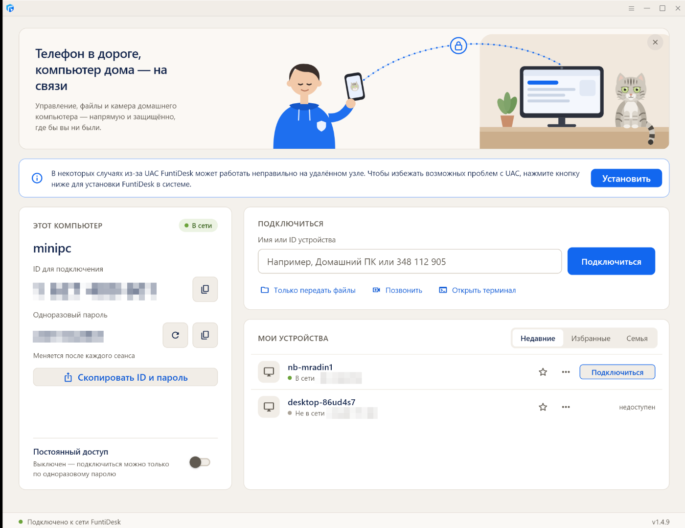
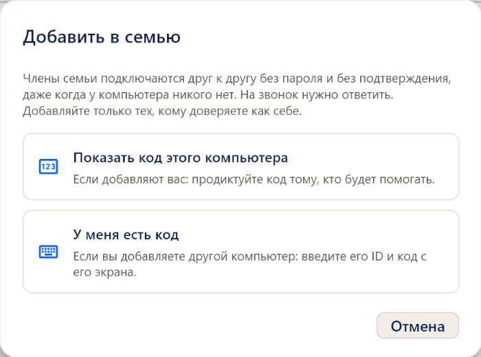
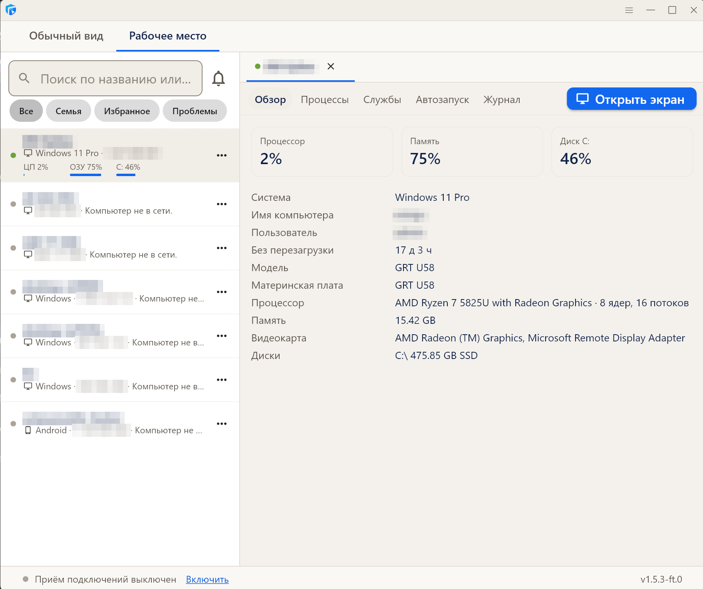
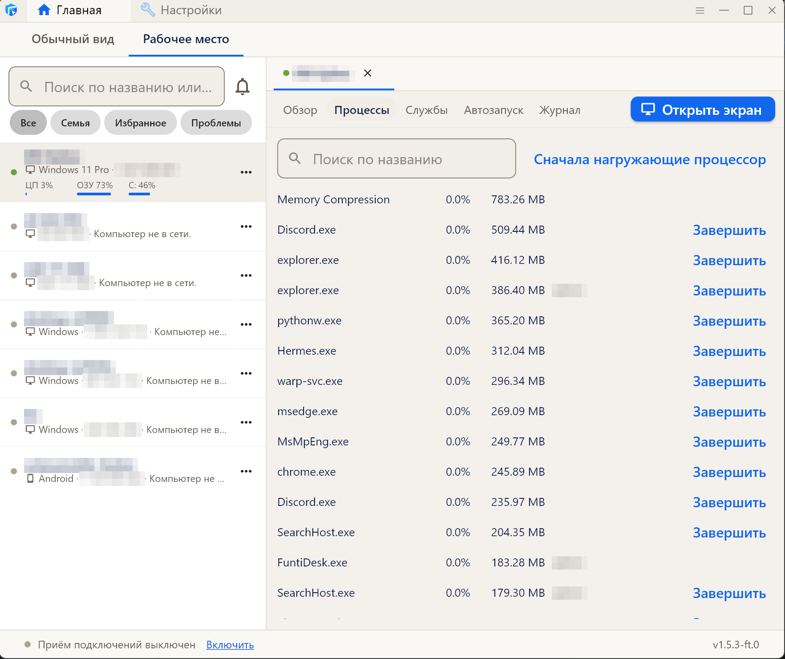
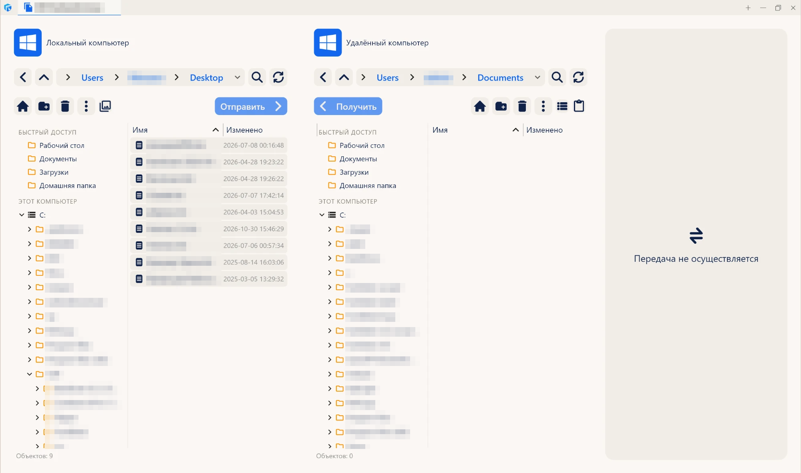

# FuntiDesk

**Удалённый доступ, звонки и помощь для своей семьи — через свой собственный сервер.**

Помочь маме с компьютером, забрать файл с домашнего ПК, позвонить домой с видео — без сторонних облаков, мессенджеров и чужих серверов. FuntiDesk работает только через инфраструктуру, которую вы контролируете сами.

## Чем FuntiDesk отличается

**Свой сервер — и больше ничего.** Клиент жёстко привязан к серверу FuntiDesk и его ключу. Никаких запасных публичных серверов: если сервер недоступен, клиент честно не подключится, а не уйдёт молча через чужую инфраструктуру.

**Не зависит от мессенджеров и облаков.** Звонки, управление и файлы идут напрямую между компьютерами или через ретранслятор на вашем сервере. Если сторонние сервисы блокируют или замедляют, FuntiDesk продолжает работать, пока доступен ваш сервер.

**Работает в «трудных» сетях.** Связь с сервером идёт по TCP, поэтому компьютер принимает подключения даже там, где провайдер или роутер режут входящий UDP — так бывает на мобильных и корпоративных сетях ([ADR-004](docs/ADR-004-tcp-signaling.md)). После смены сети (Wi-Fi, мобильный интернет, VPN) FuntiDesk сам заново проверяет подключение — без перезапуска.

**Сделан для семьи — и удобен тому, кто её компьютеры обслуживает.** Понятные слова, крупные кнопки, без диктовки девятизначных ID при каждом звонке. А для помощника — рабочее место: состояние всех компьютеров, процессы, службы и журналы без открытия экрана.

## Возможности

### Позвонить домой

Видеозвонок с голосом с одной кнопки «Позвонить». На той стороне звучит мелодия и появляется «Входящий звонок» — камера включается только после «Ответить». Видео в обе стороны, одно «положить трубку» завершает звонок на обоих компьютерах ([ADR-005](docs/ADR-005-family-calls.md)).

### Семья

Компьютеры родных сопрягаются **один раз** по коду из 6 цифр с экрана — дальше никаких паролей:

- члены семьи подключаются к управлению, файлам и терминалу сразу, на звонок — отвечают;
- каждому можно дать понятное имя: «Мама», «Ноутбук на даче»;
- удаление из семьи — взаимное: вас убирают и на той стороне;
- права каждого члена семьи настраиваются на своём компьютере: вход без пароля, управление, файлы, терминал, «Менять настройки FuntiDesk» или «Спрашивать разрешение».

Подлинность члена семьи подтверждается ключом устройства, поэтому выдать себя за члена семьи нельзя ([ADR-006](docs/ADR-006-family-access.md)).

### Попросить помощи

Одна кнопка на компьютере мамы — и у выбранного помощника всплывает «Мама просит помощи» с кнопкой «Подключиться». Не нужно диктовать ID и пароль по телефону.

### Обновление одной кнопкой

«Обновить» в «О программе» ставит последний релиз FuntiDesk: проверяет SHA256 и перезапускает программу с прежним ID и настройками. Работает в установленной версии (обновляет служба), в любой папке и в `FuntiDesk-portable.exe`. О новой версии сообщает окошко на главном экране, в нём — что изменилось.

Если у компьютера, к которому вы подключились, старая версия, в меню сеанса есть «Обновить FuntiDesk на том компьютере»: он сам скачает и проверит релиз, перезапустится, и сеанс переподключится ([ADR-007](docs/ADR-007-updates.md)).

### Личный кабинет и подключение из браузера

- **Кабинет** на [desk.funti.cc/account/](https://desk.funti.cc/account/) и в приложении: вход по коду из письма, свои устройства и списки. Вход в кабинет не даёт доступа к компьютерам; пароли и права семьи через него не передаются ([ADR-009](docs/ADR-009-account.md)).
- **Избранное и история подключений** синхронизируются между компьютерами одного аккаунта.
- **Подключение из браузера** на [desk.funti.cc/connect/](https://desk.funti.cc/connect/) с паролем компьютера — в том числе с iPhone в Safari: управление пальцем, масштаб, передача файлов ([ADR-012](docs/ADR-012-account-sync-and-browser.md), [ADR-014](docs/ADR-014-phone-web-console.md), [ADR-015](docs/ADR-015-browser-file-decoding.md)).

### Рабочее место: несколько компьютеров в одном окне

Для того, кто следит за компьютерами всей семьи или небольшого офиса. Вкладка «Рабочее место» над главным экраном:

- **слева — все компьютеры** (недавние, избранные, семья) с типом системы (Windows 11, Windows Server, Linux, Android), меткой «ВМ» у виртуальных машин и шкалами процессора, памяти и диска; группы «Семья», «Избранное», «Проблемы»;
- **справа — открытые компьютеры вкладками**, и всё это **без открытия экрана**:
  - «Обзор» — нагрузка и характеристики: модель, материнская плата, процессор, память, видеокарта, диски;
  - «Процессы», «Службы», «Автозапуск» — завершить зависшую программу, перезапустить службу, отключить лишнее в автозагрузке;
  - «Журнал» — кто и когда подключался к тому компьютеру;
- оповещения внутри окна: диск или память заполнены, компьютер пропал из сети.

Данные идут по **служебному подключению** — только к компьютерам, которыми вы и так можете управлять без подтверждения (семья или сохранённый постоянный пароль). Человеку на той стороне ничего не всплывает; каждое подключение и действие записывается в журнал того компьютера ([ADR-024](docs/ADR-024-admin-workplace.md)).

### Администрирование из сеанса

- Во время сеанса слева вверху видна нагрузка процессора, памяти и диска того компьютера.
- В меню сеанса — «Процессы…», «Службы…», «Автозапуск…», как в Диспетчере задач. Системное и сам FuntiDesk трогать нельзя; каждое действие — в журнал того компьютера ([ADR-023](docs/ADR-023-administration.md)).

### Журнал подключений

«Настройки → Доступ к компьютеру → Показать журнал»: кто и когда подключался к этому компьютеру, сколько длился сеанс, какие файлы передавались, какие попытки были отклонены. Журнал хранится только на этом компьютере ([ADR-020](docs/ADR-020-connection-journal.md)).

### Включить компьютер через другой

Подключитесь к компьютеру, который включён дома, и в меню сеанса выберите «Включить устройство в его сети…» — спящий или выключенный компьютер включится по сети (Wake-on-LAN; обычно нужен кабель) ([ADR-021](docs/ADR-021-wake-through-family.md)).

### Передача файлов как в Проводнике

- Дерево папок слева, меню правой кнопки: открыть, отправить, копировать, переименовать, удалить; Ctrl+C на одном компьютере — Ctrl+V на другом.
- Двойной щелчок по файлу другого компьютера скачивает и открывает его; программы не запускаются, а показываются в папке.
- Миниатюры фото, клавиши Проводника (Enter, Backspace, Del, F2, Ctrl+A), размер папки, «Скопировать путь», «оставить оба» при совпадении имён ([ADR-017](docs/ADR-017-file-previews-and-archives.md)).

### Всё остальное, что нужно каждый день

- **Управление** компьютером, буфер обмена, экран входа Windows и окна администратора (после «Запросить повышение»).
- **Только передать файлы** — без показа экрана; в пути работают `%переменные%`.
- **Открыть терминал** — командная строка удалённого компьютера.
- **Скопировать ID и пароль** — готовое сообщение для мессенджера одной кнопкой.
- **Мои устройства** — недавние, избранные, семья; статус «в сети».

## Безопасность

- Сервер и его ключ зашиты в клиент; соединения зашифрованы, подлинность собеседника проверяется ключом сервера (fail closed).
- Камера по одному паролю не включается: на звонок нужно ответить. Автоответ — отдельная настройка, по умолчанию выключен.
- Семья — только по коду с экрана этого компьютера; список семьи хранится на каждом устройстве, сервер о семьях ничего не знает.
- Никакого скрытого доступа: всё, что происходит на компьютере, видно на нём самом.

Подробно — [docs/SECURITY.md](docs/SECURITY.md).

## Установка на Windows

Команда установки для PowerShell (без прав администратора) — в описании [последнего релиза](../../releases/latest). Она запускает [install.ps1](install.ps1): скрипт ставит последнюю сборку в `%LOCALAPPDATA%\Programs\FuntiDesk`, проверяет SHA256, добавляет ярлык в «Пуск» и запускает FuntiDesk. Повторный запуск обновляет программу, ID и настройки сохраняются. Дальше обновлять можно кнопкой в «О программе».

Без установки — один файл `FuntiDesk-portable.exe` из [последнего релиза](../../releases/latest). Скачанный браузером файл SmartScreen предупреждает, пока у сборок нет подписи кода; установка командой выше этого предупреждения не вызывает. При первом запуске без установки FuntiDesk предложит установиться: только установленный FuntiDesk (со службой Windows) позволяет помощнику нажимать в окнах администратора и на экране входа. Служба после сбоя перезапускается сама.

## Linux (в работе)

Пакет `.deb` для x86_64 (Debian, Ubuntu 22.04 и новее, Kali; X11) — в релизах `funtidesk-linux-<коммит>` на [странице релизов](../../releases?q=funtidesk-linux-&expanded=true). Установка: `sudo apt install ./funtidesk-<версия>-x86_64.deb`. Пока это тестовая сборка, проверка на Kali идёт ([ADR-016](docs/ADR-016-linux-client.md)).

## Android (тестовая сборка)

APK для телефонов arm64 — в релизах `funtidesk-android-<коммит>` (pre-release) на [странице релизов](../../releases). Подпись отладочная: ставится вручную из файла, для проверки. Подробности — [docs/ANDROID.md](docs/ANDROID.md).

## Состояние

| | |
|---|---|
| Windows ↔ Windows: управление, файлы, терминал, P2P и ретранслятор | проверено на реальных компьютерах |
| Звонки: ответ, видео, голос, завершение с любой стороны | проверено; видео в обе стороны — проверено соединение, на двух компьютерах с камерами ещё нет |
| Семья, «Попросить помощи» | проверено на двух компьютерах |
| Обновление кнопкой, в том числе установленной версии и другого компьютера из сеанса | проверено на опубликованных релизах |
| Личный кабинет, синхронизация списков | выпущено 2026-10-17 |
| Подключение из браузера, в том числе с iPhone | управление проверено в Safari на iPhone; передача файлов в браузере влита, проверки на реальных компьютерах пока нет |
| Доступ после перезагрузки без входа в Windows | выпущено 2026-10-28: связь с сервером всегда по TCP |
| FuntiDesk рядом с RustDesk на одном компьютере | выпущено 2026-10-28: FuntiDesk не берёт ID и списки RustDesk |
| Передача файлов как в Проводнике, миниатюры фото | выпущено 2026-11-05 |
| Процессы и службы из сеанса | проверено на двух компьютерах с Windows; автозапуск — выпущено 2026-11-13 |
| Рабочее место: список хостов, обзор, разделы без экрана | проверено на двух компьютерах с Windows |
| Журналы Windows в рабочем месте | [PR #162](../../pull/162), ждёт проверки |
| Экраны нескольких компьютеров в рабочем месте | в работе |
| Журнал подключений, включение по сети | выпущено 2026-11-13 |
| Linux | тестовая сборка `.deb`, проверка на Kali идёт |
| Android | тестовая сборка, проверка на телефоне впереди |
| iPhone | через браузер (desk.funti.cc/connect/); отдельного приложения не будет без платной учётной записи Apple |

Публичный статус — [docs/ROADMAP.md](docs/ROADMAP.md).

---

## Для разработчиков

### Цель продукта

Простой и надёжный удалённый доступ, при котором идентификация, rendezvous, relay, конфигурация, релизы и будущий слой управления устройствами контролируются инфраструктурой FuntiDesk.

### Принципы

- Все production-клиенты работают только через инфраструктуру FuntiDesk.
- Числовой ID устройства сохраняется как универсальный резервный способ подключения; поверх него — понятные имена, избранное, семья.
- Сначала Windows↔Windows, затем Android, Linux и iOS (Android начат раньше Family Release ; iPhone — через браузер, ADR-014).
- Собственный интерфейс и сценарии FuntiDesk, а не перекрашенный исходный проект.
- Изменения протокола и ядра — по возможности минимальные (собственные поля протокола — с номерами от 1000).
- Поведение, связанное с безопасностью, явное, задокументированное и fail closed.

### Этапы

1. **M0 — Архитектура**: baseline, стратегия форка, лицензирование, модель доверия.
2. **M1 — Self-hosted Server**: воспроизводимое развёртывание rendezvous/relay.
3. **M2 — Windows MVP**: Windows-клиент только на инфраструктуре FuntiDesk.
4. **M3 — End-to-End Validation**: P2P, relay, NAT, перезагрузка, UAC/экран входа, файлы.
5. **M4 — Family Release**: свой интерфейс, установка одной командой, семья, звонки, безопасный неуправляемый доступ.

### Управление проектом

- GitHub — единственный источник истины для кода, архитектуры, ролей, планов, статусов (`docs/ROADMAP.md`, PR), ADR и эксплуатационной документации.
- Изменения production-поведения — через историю репозитория и задокументированные критерии приёмки.

Документы: `AGENTS.md` (правила работы), `docs/ROADMAP.md`, `docs/PRODUCT.md`, `docs/ARCHITECTURE.md`, `docs/SECURITY.md`, `docs/UPSTREAM.md`, `docs/UPSTREAM_REVIEW.md`, ADR `docs/ADR-*.md`.

### Лицензирование и атрибуция

FuntiDesk основан на открытом коде RustDesk и rustdesk-server (AGPL-3.0) и распространяется на тех же условиях. Что FuntiDesk меняет в исходниках upstream — [docs/FUNTIDESK_PATCHES.md](docs/FUNTIDESK_PATCHES.md). Сведения о лицензиях, copyright и доступности исходного кода сохраняются в репозитории и дистрибутивах там, где этого требует лицензия; пользовательский интерфейс и документация используют бренд и терминологию FuntiDesk.
