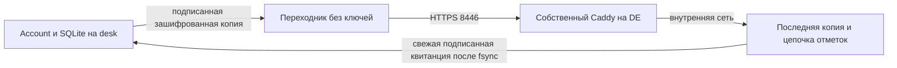

# ADR-011: независимое состояние для восстановления личного кабинета

Дата: 2026-10-14. **Статус: предложение и проверенный локально прототип; рабочий запуск не разрешён.**

Основание: ADR-009, проект ADR-010, [передача работ](reviews/2026-10-13-handoff-account.md). Восстановление из старой базы не должно возвращать удалённый семейный ключ или повторно использовать номера событий. Обычный архив базы не доказывает отсутствие более поздних отзывов.

## Предлагаемое решение

На отдельном сервере `de.funti.cc` хранится последняя зашифрованная согласованная копия SQLite и неизменяемая цепочка отметок. Это отдельный сервис, а не агент Hermes и не MCP. Рабочий account остаётся на `desk.funti.cc`. У сервисов разные каталоги данных; резервное копирование основного сервера не перезаписывает независимое хранилище.

Изменения аккаунтов, идентичностей устройств, содержимого копий семьи, событий и подтверждений увеличивают ревизию в той же транзакции SQLite. API выдаёт результат только после независимого сохранения этой ревизии. Пока есть неподтверждённое изменение, чтение данных кабинета также закрыто. Существующая локальная семья и подключение по ID/паролю от этого сервиса не зависят.

Порядок: транзакция → согласованная копия через SQLite Online Backup → шифрование → устойчивый локальный `pending.json` → независимые файлы с `fsync` → подтверждение → локальная квитанция → ответ API. Независимая запись принимается только поверх точного предыдущего состояния. Потерянный ответ допускает повтор той же записи; другое содержимое с тем же номером отклоняется. Начатая операция завершается при обрыве HTTP-запроса, удерживая блокировку; очередь ограничена 32 операциями.

Служебные heartbeat и повтор неизменённой копии/ACK не создают новую зашифрованную копию. Изменение имени или версии устройства сохраняется. `updated_at` и `last_seen` после восстановления могут отражать время последней существенной записи.

## Защита и граница доверия

Данные шифруются XChaCha20-Poly1305 с новым случайным nonce. Ключ выводится из основного account-ключа HMAC с отдельным назначением и случайным namespace. Он не передаётся независимому серверу. Предыдущее состояние, ревизия и максимальный номер события входят в аутентифицируемые данные. Секреты не коммитятся.

У account и независимого сервиса есть отдельный общий машинный HMAC-ключ. Запросы, ответы и отметки цепочки подписаны с разными назначениями. Каждый ответ привязан к свежему случайному nonce запроса: старый ответ `head` не годится для новой проверки. Почтовая сессия не даёт доступа к этому каналу. Внешний транспорт — HTTPS `de.funti.cc:8446/v1/witness`, без редиректов и системных прокси.

Account не получает исходящую сеть. Отдельный контейнер-переходник пересылает только подписанное тело по закреплённому HTTPS-адресу; у него нет ключей и томов данных. Независимый сервис слушает внутренний порт за собственным Caddy. Сервисы не подключаются к базе VPN, его сети или данным других приложений.

**Независимое хранилище является доверенной точкой свежести.** Его полная замена старой копией вместе с ключом/namespace не обнаруживается этой схемой. Его нельзя откатывать вслед за основной базой или заново инициализировать после потери данных. При потере последнего состояния восстановление кабинета закрыто до отдельного решения; старый архив не объявляется безопасным. Схема также не защищает от администратора, имеющего все серверные ключи. Эти границы обязательны для регламента, а не скрытый fallback.

## Запуск, восстановление и ограничения

Создание пустого состояния — отдельные команды `witness-init` и `initialize`. Обычный запуск отказывается от отсутствующей базы/метаданных, неверного ключа, разрыва цепочки, несовпадения ревизии или устаревшего состояния. Уже существующая база без независимого состояния не мигрирует автоматически. На рабочих серверах кабинета сейчас нет, поэтому для первого запуска нужен явно новый namespace.

Восстанавливается только последняя подтверждённая копия и только в новый путь. Проверяются свежая отметка до и после загрузки, шифрование, `integrity_check`, внешние ключи, namespace, ревизия и `sqlite_sequence` событий. Затем удаляются все сессии, challenge и nonce. Идентичности источников, копии семьи, события, `request_id` и ACK сохраняются. Следующее событие получает номер больше прежнего максимума. Копии семьи не импортируются в доверие клиента; клиент со старым курсором повторно получает уже подтверждённые отзывы.

Предел копии — 16 МиБ; тела — 24 МиБ с небольшим запасом для метаданных; независимых запросов — 2; срок — 20 секунд. Хранятся две последние зашифрованные копии и до 100 000 небольших отметок. Достижение предела или ошибка диска закрывает запись. Цепочку нельзя очищать обычным cleanup; расширение/архивация требует отдельного проверенного регламента. Полная копия на существенное изменение подходит для прототипа семейного сервиса; нагрузка и дисковый запас проверяются до рабочего запуска.

Операционный порядок: [ACCOUNT_RECOVERY.md](ACCOUNT_RECOVERY.md). Проверки: [отчёт восстановления](reviews/2026-10-14-account-recovery-check.md). RPO подтверждённых изменений в пределах этой схемы — 0; время восстановления на реальном сервере ещё не измерено.

## Решения до рабочего запуска

Нужны утверждение этой схемы и ADR-010, порядок хранения независимых ключей/копий, проверка восстановления на отдельной машине, сроки хранения и удаление аккаунта. Нельзя удалять последние отзывы так, чтобы долго выключенный клиент снова доверял ключу. Поведение уже открытых семейных сеансов при отзыве остаётся отдельным вопросом ADR-010. Рабочие изменения серверов, merge и выпуск требуют согласия владельца по передаче.
